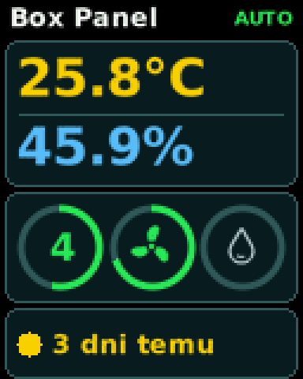
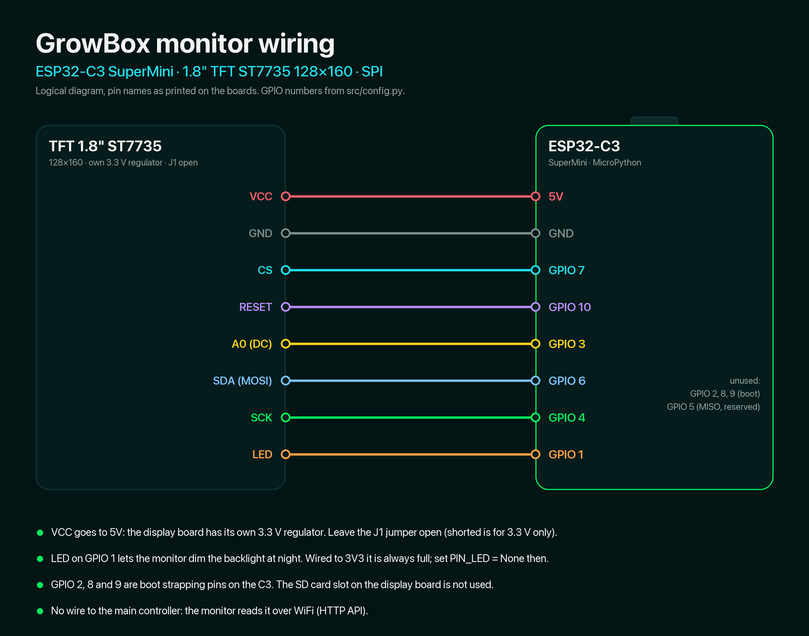
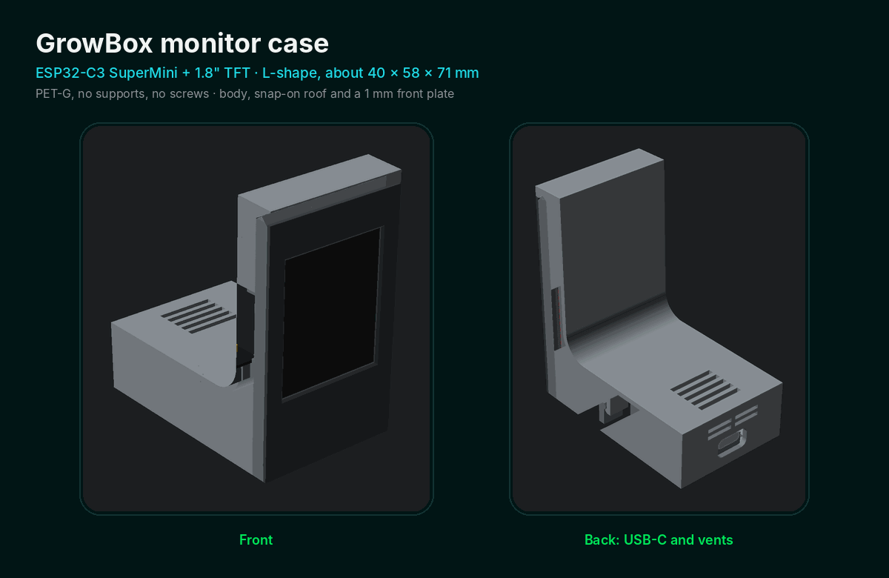

# Growbox external monitor

A small hardware widget for the GrowBox: an ESP32-C3 SuperMini with a
1.8" colour TFT (ST7735, 128x160) shows the GrowBox state like the macOS
widget, in a layout made for the small screen. It asks the main ESP over
WiFi, so nothing changes on the GrowBox itself.



Black background and large type, because the TFT has little contrast.
There is no chart.

- temperature (yellow) and humidity (blue), large, without labels
- rings: flowering week (number, ring = progress through the week), fan
  (ring = speed), humidifier (blue = running, grey = waiting, red =
  enabled but the mini ESP is offline)
- watering in one line: when it was last fed (today, yesterday, n days
  ago); the dot is green, yellow on day 3, red from day 4 (the text too),
  like the app
- `AUTO` / `MANUAL` in the header, `OFFLINE` when the main ESP stops
  answering (the last values stay on screen)

## Hardware



| Display pin | ESP32-C3 SuperMini |
| ----------- | ------------------ |
| VCC         | 5V                 |
| GND         | GND                |
| CS          | GPIO 7             |
| RESET       | GPIO 10            |
| A0 (DC)     | GPIO 3             |
| SDA (MOSI)  | GPIO 6             |
| SCK         | GPIO 4             |
| LED         | GPIO 1 (or 3V3)    |

- The display board has its own 3.3 V regulator, so VCC goes to 5V. Leave
  the J1 jumper open (shorting it bypasses the regulator, for 3.3 V only).
- GPIO 2, 8 and 9 are boot strapping pins on the C3, so they are not
  used. GPIO 5 is reserved as SPI MISO (the display does not send
  anything back).
- LED on GPIO 1 lets the monitor dim the backlight at night
  (`BACKLIGHT_NIGHT`, 22:00-07:00). Wired to 3V3 it is always full; set
  `PIN_LED = None` then.
- On / off and the day brightness are set in the app (Settings, Monitor).
  They live in the main ESP's config (`monitor`, `POST /api/monitor`), so
  the monitor picks them up on its next poll, within 15 s. At night the
  brightness is capped at `BACKLIGHT_NIGHT`.
- The SD card slot on the back is not used.

## Case



An L-shaped 3D-printed case. The OpenSCAD source is
`case/case.scad`; the parts in `case/`:

| File              | Part                                   | Printing                        |
| ----------------- | -------------------------------------- | ------------------------------- |
| `case_body.stl`  | body                                   | bottom down, no supports        |
| `case_roof.stl`  | roof                                   | on its side, with a brim        |
| `front_plate.stl` | 1 mm front plate, glued on             |                                 |
| `screen.stl`     | screen dummy for test fitting          | not printed                     |

Printed in PET-G on a Creality KE with a 0.4 mm nozzle.

## Install (USB)

1. Flash MicroPython for the C3 (the image is in
   `growbox-firmware/MicroPython`):

   ```bash
   esptool --chip esp32c3 --port /dev/cu.usbmodem21101 erase-flash
   esptool --chip esp32c3 --port /dev/cu.usbmodem21101 write-flash -z 0x0 ESP32_GENERIC_C3-20260824-v1.29.0.bin
   ```

2. Check the display first, without WiFi:

   ```bash
   mpremote connect /dev/cu.usbmodem21101 cp src/config.py src/st7735.py :
   mpremote connect /dev/cu.usbmodem21101 run src/test.py
   ```

   You should see a white frame on the very edge, `TOP` at the top and
   red, green and blue bars. If not, adjust `src/config.py`:

   | What you see                      | Change                        |
   | --------------------------------- | ----------------------------- |
   | red and blue swapped              | `TFT_BGR = True`              |
   | upside down                       | `TFT_FLIP = False`            |
   | frame cut off / noise at an edge  | `TFT_X_OFFSET, TFT_Y_OFFSET = 2, 1` |
   | colours inverted                  | `TFT_INVERT = True`           |

3. Create `src/secrets.py` from `src/secrets_example.py`: WiFi and the
   `API_TOKEN` from the main ESP's `src/api_token.py`. It is not committed.

4. Copy the rest. `assets.py` (fonts and icons) is big as source, so it
   goes precompiled; the other files can go as `.py`:

   ```bash
   mpy-cross src/assets.py -o assets.mpy
   mpremote connect /dev/cu.usbmodem21101 cp assets.mpy :
   mpremote connect /dev/cu.usbmodem21101 cp src/config.py src/secrets.py src/gfx.py src/model.py src/net.py src/st7735.py src/ui.py src/main.py :
   mpremote connect /dev/cu.usbmodem21101 reset
   ```

   `mpy-cross` has to match the MicroPython version on the board
   (`pipx install mpy-cross==1.29.0`, or the version you flashed).

## How it talks to the GrowBox

- `GET /api/config` every 15 s, and nothing else (the widget uses 10 s;
  the main ESP serves one request at a time and has little RAM, so the
  monitor stays gentler).
- After three failed requests it looks for the main ESP: first
  `esp32.local`, then the /24 network, addresses nearest the old one
  first. The address it finds is kept in `host.txt` on the board.
- The clock comes from NTP (Polish time, summer time included); the week
  and the watering days need it.

Intervals, the address and the backlight are in `src/config.py`.

## Robustness

- Hardware watchdog (30 s); every network call has a timeout.
- Ten errors in a row reset the board.
- Out of memory: the loop collects garbage and carries on (it counts as
  an error).

## Preview on a computer

`tools/preview.py` draws the screen with the same `ui.py` and `model.py`
(using a small `framebuf` stand-in) and saves a PNG:

```bash
pip install pillow
python3 tools/preview.py                                   # sample data
python3 tools/preview.py --esp 192.168.18.100 --token ...  # live data
python3 tools/preview.py --boot "Connecting WiFi"          # boot screen
```

`tools/gen_assets.py` regenerates `src/assets.py` (DejaVu Sans fonts,
the fan and drop icons) when a size or a character is missing.
`tools/gen_wiring.py` redraws `docs/wiring.png`.

## Layout

```
src/
  main.py       loop: WiFi, clock, polling, drawing, watchdog
  net.py        WiFi, NTP, HTTP to the main ESP, search for its address
  model.py      ESP data -> what the screen shows (week, watering, fan)
  ui.py         the screen layout
  gfx.py        colours, anti-aliased text, cards, rings
  st7735.py     display driver with a frame buffer
  assets.py     generated fonts and icons
  config.py     pins, display variant, intervals
  test.py       display test pattern
tools/
  preview.py    render the screen to PNG on a computer
  gen_assets.py build src/assets.py
  framebuf.py   framebuf stand-in for the preview
  gen_wiring.py draw docs/wiring.png
```

## License

This project is licensed under [CC BY-NC 4.0](https://creativecommons.org/licenses/by-nc/4.0/):
you may use, share and modify it for non-commercial purposes, with credit to
growbox-DIY. See LICENSE.
